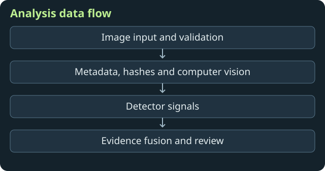
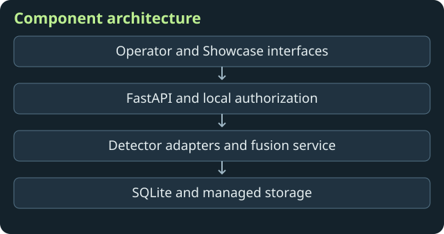
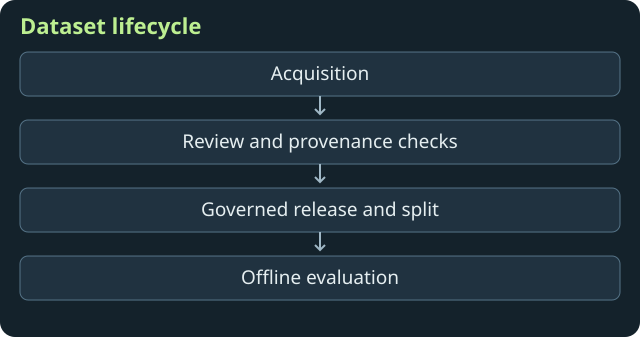
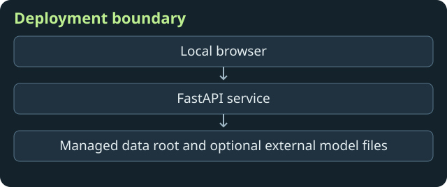

# AuthenticityAI | Engineering case study

[Portfolio index](../../README.md) · [Website case study](../../authenticityai.html)

## Application overview

Ingested images feed metadata and quality extraction, forensic and optional learned detectors, and evidence fusion. Hashes support identity and provenance. SQLite stores review and dataset state. Model governance and offline evaluation remain distinct from inference. Research outputs do not establish commercial accuracy.

## Technology stack

Python, FastAPI, SQLite, OpenCV, MediaPipe, optional learned detectors

## System architecture

## Flowcharts and component interactions

### Component architecture

### Dataset lifecycle

### Deployment boundary

## Source code examples

These are exact, illustrative excerpts from the private source commits identified below. Each depends on surrounding application code, framework context, or schema and is not an independently runnable example. File extensions are retained for GitHub syntax highlighting.

### Withhold an unsupported verdict

[Browse fusion-failed-result.py](examples/fusion-failed-result.py)

Origin: fusion/engine.py:30–47, FusionEngine._failed_result, commit 1cb33a7af7594430733c04e44d198b579766457d.

When the evidence pipeline cannot apply its policy, the result explicitly says that the decision is inconclusive.

**Inputs, outputs, and control flow.** Accepts an error reason. Builds a FusionResult with neutral scores, zero confidence and no contributions, then adds the compatibility fields consumed by callers.

**Design decisions and security.** The engine keeps the public response shape even when policy or inputs are invalid. The neutral score is a sentinel and should not be interpreted as a calibrated probability. Fusion weighting and model configuration are omitted.

**Test evidence.** tests/test_fusion.py exercises fusion policy and response behavior. The source snapshot passed 472 Python and 28 JavaScript tests.

## Testing and validation

The sanitized source snapshot passed 472 Python and 28 JavaScript tests with disposable SQLite fixtures and the OpenCV fallback. Restricted models and research datasets were outside the run.

## Security considerations and known limitations

This is a research application. The result does not establish commercial detection accuracy. Optional datasets and model weights require separately verified access and rights.

## Future development roadmap

- Use a stable error code for clients while limiting potentially sensitive diagnostic detail at the API boundary.

## AI-assisted development

Development and preparation of this portfolio included AI assistance. The code is transcribed from verified commits. Individual implementation authorship is not asserted.

## Expanded source review

[Full module collection](source/README.md) · [Pinned engineering metrics](../../METRICS.md)
