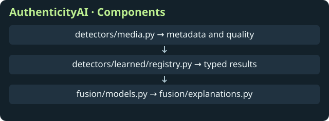
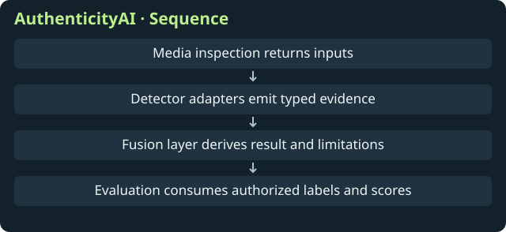

# AuthenticityAI · Source collection

[Case study](../../../authenticityai.html) · [Measurement method](../../../METRICS.md)

## Source status

Media decoding and integrity checks feed metadata, quality and detector interfaces. The fusion engine translates detector output into typed evidence, explanation and limitations. Evaluation modules operate on controlled inputs.

Weighted fusion and noise heuristics require explicit public IP clearance. Runtime SQLite files, evidence, external artifact weights and research datasets are excluded.

These full files are transcribed from the pinned commit. Many depend on omitted application components. They are review material and are not offered as a runnable package.

## Implementation diagrams

## Module walkthroughs

### detectors/media.py

[Browse the exact module](detectors/media.py) · 65 nonblank lines · Services and modules

Handle media inspection and decoding at the input boundary.

**Declarations and dependencies.** decode_image, load_and_sample_video Imports: from pathlib import Path, from tempfile import NamedTemporaryFile, import cv2, import numpy as np, from path_management import MANAGED_PATHS

**Design and control flow.** Explicit resource or error handling. Media decoding and integrity checks feed metadata, quality and detector interfaces. The fusion engine translates detector output into typed evidence, explanation and limitations. Evaluation modules operate on controlled inputs.

**Error and security boundary.** No explicit raise found in the declaration scan. Errors may propagate from dependencies. Treat outputs as evidence with uncertainty. Optional model binaries and their licensing remain outside the tree.

**Testing and trade-off.** Application test evidence is documented on the case study. The module retains the original interfaces and imports, which preserve design context and limit standalone execution.

### detectors/metadata.py

[Browse the exact module](detectors/metadata.py) · 253 nonblank lines · Services and modules

Extract metadata fields that can be reviewed as evidence.

**Declarations and dependencies.** _clean_value, _software_warnings, _empty_video_metadata, inspect_image_metadata, inspect_video_metadata Imports: import io, import json, import shutil, import subprocess, from pathlib import Path, from tempfile import NamedTemporaryFile, from path_management import MANAGED_PATHS, from PIL import Image, UnidentifiedImageError

**Design and control flow.** Explicit resource or error handling. Media decoding and integrity checks feed metadata, quality and detector interfaces. The fusion engine translates detector output into typed evidence, explanation and limitations. Evaluation modules operate on controlled inputs.

**Error and security boundary.** No explicit raise found in the declaration scan. Errors may propagate from dependencies. Treat outputs as evidence with uncertainty. Optional model binaries and their licensing remain outside the tree.

**Testing and trade-off.** Application test evidence is documented on the case study. The module retains the original interfaces and imports, which preserve design context and limit standalone execution.

### detectors/quality.py

[Browse the exact module](detectors/quality.py) · 49 nonblank lines · Services and modules

Compute media-quality signals used by the analysis pipeline.

**Declarations and dependencies.** analyze_image_quality, analyze_video_quality Imports: import cv2, import numpy as np

**Design and control flow.** Modular application boundary. Media decoding and integrity checks feed metadata, quality and detector interfaces. The fusion engine translates detector output into typed evidence, explanation and limitations. Evaluation modules operate on controlled inputs.

**Error and security boundary.** No explicit raise found in the declaration scan. Errors may propagate from dependencies. Treat outputs as evidence with uncertainty. Optional model binaries and their licensing remain outside the tree.

**Testing and trade-off.** Application test evidence is documented on the case study. The module retains the original interfaces and imports, which preserve design context and limit standalone execution.

### detectors/timing.py

[Browse the exact module](detectors/timing.py) · 35 nonblank lines · Services and modules

Record detector runtime information as diagnostics.

**Declarations and dependencies.** development_timing_enabled, log_timing, timed_stage Imports: import json, import logging, import os, import time, from contextlib import contextmanager

**Design and control flow.** Explicit resource or error handling. Media decoding and integrity checks feed metadata, quality and detector interfaces. The fusion engine translates detector output into typed evidence, explanation and limitations. Evaluation modules operate on controlled inputs.

**Error and security boundary.** No explicit raise found in the declaration scan. Errors may propagate from dependencies. Treat outputs as evidence with uncertainty. Optional model binaries and their licensing remain outside the tree.

**Testing and trade-off.** Application test evidence is documented on the case study. The module retains the original interfaces and imports, which preserve design context and limit standalone execution.

### detectors/learned/registry.py

[Browse the exact module](detectors/learned/registry.py) · 103 nonblank lines · Services and modules

Aggregate adapter results through a shared detector contract.

**Declarations and dependencies.** LearnedDetectorRegistry Imports: from collections import OrderedDict, import time, from detectors.learned.aide import AIDEDetector, from detectors.learned.clip_sid import CLIPSIDDetector, from detectors.learned.ssp import SSPDetector, from detectors.learned.trufor import TruForDetector, from detectors.learned.universal_fake import UniversalFakeDetector

**Design and control flow.** Typed or encapsulated state, Explicit resource or error handling. Media decoding and integrity checks feed metadata, quality and detector interfaces. The fusion engine translates detector output into typed evidence, explanation and limitations. Evaluation modules operate on controlled inputs.

**Error and security boundary.** No explicit raise found in the declaration scan. Errors may propagate from dependencies. Treat outputs as evidence with uncertainty. Optional model binaries and their licensing remain outside the tree.

**Testing and trade-off.** Application test evidence is documented on the case study. The module retains the original interfaces and imports, which preserve design context and limit standalone execution.

### detectors/evidence/base.py

[Browse the exact module](detectors/evidence/base.py) · 148 nonblank lines · Interfaces

Define a typed interface used across independently implemented adapters.

**Declarations and dependencies.** clamp, EvidenceObject, DetectorResult, DetectorContext, EvidenceDetector Imports: from __future__ import annotations, import time, from dataclasses import asdict, dataclass, field, from typing import Any, import cv2, import numpy as np

**Design and control flow.** Typed or encapsulated state, Explicit resource or error handling. Media decoding and integrity checks feed metadata, quality and detector interfaces. The fusion engine translates detector output into typed evidence, explanation and limitations. Evaluation modules operate on controlled inputs.

**Error and security boundary.** NotImplementedError Treat outputs as evidence with uncertainty. Optional model binaries and their licensing remain outside the tree.

**Testing and trade-off.** Application test evidence is documented on the case study. The module retains the original interfaces and imports, which preserve design context and limit standalone execution.

### fusion/models.py

[Browse the exact module](fusion/models.py) · 78 nonblank lines · Models and contracts

Define structured result types consumed by the analysis pipeline.

**Declarations and dependencies.** clamp, EvidenceContribution, FusionResult Imports: from __future__ import annotations, from dataclasses import asdict, dataclass, field, from typing import Any

**Design and control flow.** Typed or encapsulated state. Media decoding and integrity checks feed metadata, quality and detector interfaces. The fusion engine translates detector output into typed evidence, explanation and limitations. Evaluation modules operate on controlled inputs.

**Error and security boundary.** ValueError Treat outputs as evidence with uncertainty. Optional model binaries and their licensing remain outside the tree.

**Testing and trade-off.** Application test evidence is documented on the case study. The module retains the original interfaces and imports, which preserve design context and limit standalone execution.

### fusion/explanations.py

[Browse the exact module](fusion/explanations.py) · 20 nonblank lines · Services and modules

Turn evidence contributions into reasons and limitations.

**Declarations and dependencies.** contribution_sentence, build_explanations Imports: No package-level imports detected.

**Design and control flow.** Modular application boundary. Media decoding and integrity checks feed metadata, quality and detector interfaces. The fusion engine translates detector output into typed evidence, explanation and limitations. Evaluation modules operate on controlled inputs.

**Error and security boundary.** No explicit raise found in the declaration scan. Errors may propagate from dependencies. Treat outputs as evidence with uncertainty. Optional model binaries and their licensing remain outside the tree.

**Testing and trade-off.** Application test evidence is documented on the case study. The module retains the original interfaces and imports, which preserve design context and limit standalone execution.

### evaluation/metrics.py

[Browse the exact module](evaluation/metrics.py) · 156 nonblank lines · Services and modules

Compute evaluation measures on labeled scores.

**Declarations and dependencies.** _validate, confusion, _safe, roc_auc, pr_auc, expected_calibration_error, binary_metrics, bootstrap_confidence_intervals, grouped_metrics, confidence_band_metrics Imports: from __future__ import annotations, import math, import random, from collections import defaultdict

**Design and control flow.** Modular application boundary. Media decoding and integrity checks feed metadata, quality and detector interfaces. The fusion engine translates detector output into typed evidence, explanation and limitations. Evaluation modules operate on controlled inputs.

**Error and security boundary.** ValueError Check input boundaries and scope where this module meets its callers. Runtime data and secrets belong outside the repository.

**Testing and trade-off.** Application test evidence is documented on the case study. The module retains the original interfaces and imports, which preserve design context and limit standalone execution.

### evaluation/splits.py

[Browse the exact module](evaluation/splits.py) · 56 nonblank lines · Services and modules

Maintain evaluation split boundaries for review and training workflows.

**Declarations and dependencies.** _bucket, assign_standard_splits, _family_name, leave_one_family_out, content_category_suites Imports: from __future__ import annotations, import hashlib, from collections import defaultdict, from evaluation.leakage import build_families

**Design and control flow.** Modular application boundary. Media decoding and integrity checks feed metadata, quality and detector interfaces. The fusion engine translates detector output into typed evidence, explanation and limitations. Evaluation modules operate on controlled inputs.

**Error and security boundary.** ValueError Check input boundaries and scope where this module meets its callers. Runtime data and secrets belong outside the repository.

**Testing and trade-off.** Application test evidence is documented on the case study. The module retains the original interfaces and imports, which preserve design context and limit standalone execution.

### tests/test_metadata.py

[Browse the exact module](tests/test_metadata.py) · 115 nonblank lines · Tests

Exercise observable behavior with local test fixtures and assertions.

**Declarations and dependencies.** make_jpeg, ImageMetadataTests, VideoMetadataTests Imports: import io, import json, import subprocess, import unittest, from unittest.mock import patch, from PIL import Image, from detectors.metadata import NO_METADATA_CONTEXT, inspect_image_metadata, inspect_video_metadata

**Design and control flow.** Typed or encapsulated state, Fixture-based behavioral verification. Media decoding and integrity checks feed metadata, quality and detector interfaces. The fusion engine translates detector output into typed evidence, explanation and limitations. Evaluation modules operate on controlled inputs.

**Error and security boundary.** No explicit raise found in the declaration scan. Errors may propagate from dependencies. Fixtures exercise local behavior. Review fixture provenance and keep credentials and customer data out of public examples.

**Testing and trade-off.** Application test evidence is documented on the case study. The module retains the original interfaces and imports, which preserve design context and limit standalone execution.

### tests/test_fusion.py

[Browse the exact module](tests/test_fusion.py) · 187 nonblank lines · Tests

Exercise observable behavior with local test fixtures and assertions.

**Declarations and dependencies.** learned, forensic, FusionTests Imports: import json, import tempfile, import unittest, from pathlib import Path, from fusion import EvidenceContribution, FusionEngine, FusionPolicyError, load_policy, import web_ui

**Design and control flow.** Typed or encapsulated state, Explicit resource or error handling, Fixture-based behavioral verification. Media decoding and integrity checks feed metadata, quality and detector interfaces. The fusion engine translates detector output into typed evidence, explanation and limitations. Evaluation modules operate on controlled inputs.

**Error and security boundary.** No explicit raise found in the declaration scan. Errors may propagate from dependencies. Fixtures exercise local behavior. Review fixture provenance and keep credentials and customer data out of public examples.

**Testing and trade-off.** Application test evidence is documented on the case study. The module retains the original interfaces and imports, which preserve design context and limit standalone execution.

## AI-assisted development

Designed and developed using AI-assisted software engineering tools, including ChatGPT and Codex.
