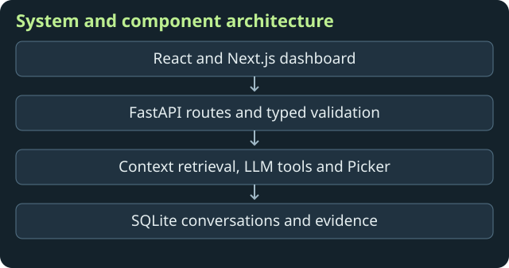
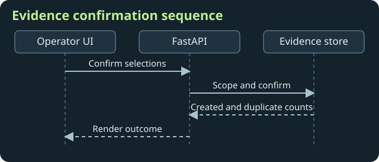
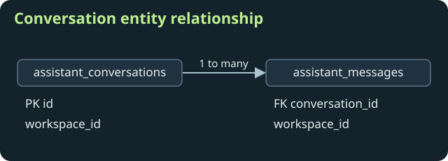
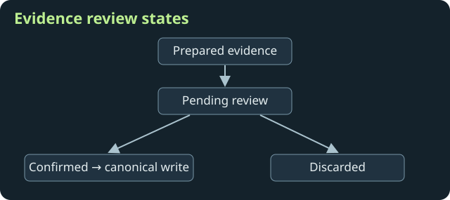
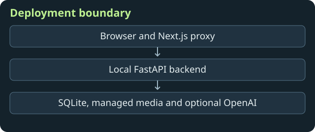

# Culinary IQ | Engineering case study

[Portfolio index](../../README.md) · [Website case study](../../culinary-iq.html)

## Application overview

The Next.js and React dashboard calls FastAPI through a backend proxy. Assistant orchestration retrieves versioned manual sections, calls OpenAI with validated tools, and persists conversations. Picker contributes media evidence. Prepared locations require explicit human confirmation. The current workspace resolver uses a fixed development identity; production tenant isolation is unverified.

## Technology stack

Next.js, React, TypeScript, Python, FastAPI, SQLite, OpenAI, Picker

## System architecture

## Flowcharts and component interactions

### Confirmation sequence

### Conversation entity relationship

### Evidence state flow

### Deployment boundary

## Source code examples

These are exact, illustrative excerpts from the private source commits identified below. Each depends on surrounding application code, framework context, or schema and is not an independently runnable example. File extensions are retained for GitHub syntax highlighting.

### Submit reviewed selections

[Browse pending-evidence-confirm.tsx](examples/pending-evidence-confirm.tsx)

Origin: frontend/src/components/photo-iq/pending-evidence-review.tsx:50–59, PendingEvidenceReview.confirm, commit 1c7febcbef4a7de39ae9877502994ecbeb268968.

The React review screen saves only the locations the human selected.

**Inputs, outputs, and control flow.** The handler reads the current bundle and selection, strips UI-only indices and sends typed locations to the API client. Success refreshes parent state and closes the review. Failure becomes an error message; finally clears saving state.

**Design decisions and security.** React state controls feedback. The server still owns validation and duplicate checks. Hiding or disabling a button alone cannot authorize writes. The callback runs after a successful response, so callback failure and write failure deserve different UI treatment.

**Test evidence.** tests/test_assistant.py verifies backend confirmation and duplicate handling. The snapshot also passed frontend unit tests and a production build; this handler has no independently verified interaction-test result.

### Confirm a pending bundle

[Browse confirm-evidence-bundle.py](examples/confirm-evidence-bundle.py)

Origin: app/api/routes/assistant.py:143–148, confirm_evidence_bundle, commit 1c7febcbef4a7de39ae9877502994ecbeb268968.

FastAPI provides a dedicated endpoint for the human-confirmation action.

**Inputs, outputs, and control flow.** Takes a bundle ID, validated location payload and injected workspace identifier. Delegates storage to confirm_locations. A domain error becomes an HTTP status with a structured code and message.

**Design decisions and security.** Separates transport behavior from transactional writes and duplicate handling. The workspace dependency returns a fixed development identity, so resource scoping is not equivalent to authenticated tenant isolation.

**Test evidence.** tests/test_assistant.py includes test_review_confirmation_creates_only_nonduplicate_locations and separate workspace-scoping checks.

### Persist conversation messages

[Browse assistant-messages.sql](examples/assistant-messages.sql)

Origin: migrations/013_culinary_iq_assistant.sql:15–37, assistant_messages and assistant_message_history_idx, commit 1c7febcbef4a7de39ae9877502994ecbeb268968.

The database records messages and their supporting context so an operator can resume a conversation.

**Inputs, outputs, and control flow.** The migration declares message identifiers, roles, content, metadata and a conversation foreign key. It creates a composite index for workspace-scoped chronological history.

**Design decisions and security.** A role CHECK rejects invalid roles. The foreign key can cascade deletes when foreign-key enforcement is enabled. The workspace index accelerates scoped reads but does not establish identity or authorize a request.

**Test evidence.** tests/test_assistant.py covers creating, retrieving and archiving conversations against migrated SQLite fixtures.

## Testing and validation

The sanitized source snapshot passed 217 backend tests, eight frontend unit tests, and a Next.js production build.

## Security considerations and known limitations

The current workspace resolver uses a fixed development identity. Authentication, workspace membership, and tenant-isolation verification are required before external deployment.

## Future development roadmap

- Add a component test for failed saves and a separate outcome for post-save refresh failure.
- Bind the workspace to authenticated membership and test forbidden and duplicate requests.
- Measure query plans and enforce workspace consistency across parent and child rows where schema changes permit.

## AI-assisted development

Designed and developed using AI-assisted software engineering tools, including ChatGPT and Codex.

## Expanded source review

[Full module collection](source/README.md) · [Pinned engineering metrics](../../METRICS.md)
