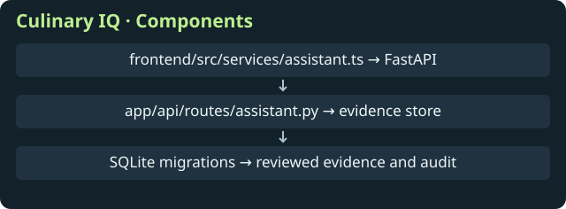
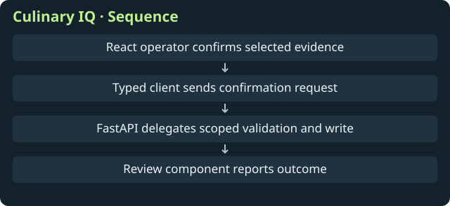

# Culinary IQ · Source collection

[Case study](../../../culinary-iq.html) · [Measurement method](../../../METRICS.md)

## Source status

React sends a typed request through FastAPI. The service retrieves manual passages and invokes bounded OpenAI tools. SQLite records conversations, evidence and confirmation results. Picker supplies extraction contracts.

Provider prompts, internal operational guidance, and business-specific branches require rights review. The app’s fixed development identity does not provide verified external tenant isolation.

These full files are transcribed from the pinned commit. Many depend on omitted application components. They are review material and are not offered as a runnable package.

## Implementation diagrams

## Module walkthroughs

### app/api/routes/assistant.py

[Browse the exact module](app/api/routes/assistant.py) · 161 nonblank lines · API routes

Expose typed FastAPI routes for conversation, manual and evidence operations.

**Declarations and dependencies.** _development_only, _error, capabilities, create_conversation, list_conversations, get_conversation, create_message, archive_conversation, update_conversation_context, upload_evidence, conversation_evidence, uploaded_evidence, uploaded_evidence_content, pending_evidence_bundles Imports: from fastapi import APIRouter, Depends, File, Header, HTTPException, Query, Response, UploadFile, status, from fastapi.responses import FileResponse, from app.core.config import settings, from app.core.workspace import get_workspace_id, from app.schemas.assistant import AssistantCapabilities, AssistantContextEnvelope, AssistantContextUpdate, AssistantConversation, AssistantConversationCreate, AssistantEvidenceBundle, AssistantEvidenceConfirm, AssistantEvidenceUploadResult, AssistantMessageSend, AssistantSendResult, from app.services import assistant_store, from app.services import assistant_evidence_store, from app.services import evidence_intake, from app.services.assistant_manual import INDEX_PIN_PATH, ManualValidationError, list_manual_index_versions, load_manual_index, preview_manual_source, rebuild_manual_index, rollback_manual_index, search_manual, from app.services.assistant_service import AssistantError, send_message, from app.services.assistant_tools import TOOL_DEFINITIONS, feature_capabilities, from app.services.restaurant_directory_store import restaurant_directory

**Design and control flow.** Asynchronous boundary, Explicit resource or error handling. React sends a typed request through FastAPI. The service retrieves manual passages and invokes bounded OpenAI tools. SQLite records conversations, evidence and confirmation results. Picker supplies extraction contracts.

**Error and security boundary.** HTTPException, _error Check input boundaries and scope where this module meets its callers. Runtime data and secrets belong outside the repository.

**Testing and trade-off.** Application test evidence is documented on the case study. The module retains the original interfaces and imports, which preserve design context and limit standalone execution.

### app/schemas/assistant.py

[Browse the exact module](app/schemas/assistant.py) · 151 nonblank lines · Models and contracts

Define typed assistant inputs, outputs and validation boundaries.

**Declarations and dependencies.** AssistantCurrentFormContext, AssistantContextEnvelope, AssistantConversationCreate, AssistantMessageSend, AssistantContextUpdate, AssistantAction, AssistantMessage, AssistantConversation, AssistantSendResult, AssistantCapabilities, AssistantEvidenceUpload, AssistantEvidenceUploadResult, AssistantLocationEvidence, AssistantEvidencePrepare Imports: from __future__ import annotations, from datetime import datetime, from typing import Any, Literal, from pydantic import BaseModel, Field, field_validator

**Design and control flow.** Typed or encapsulated state. React sends a typed request through FastAPI. The service retrieves manual passages and invokes bounded OpenAI tools. SQLite records conversations, evidence and confirmation results. Picker supplies extraction contracts.

**Error and security boundary.** ValueError Check input boundaries and scope where this module meets its callers. Runtime data and secrets belong outside the repository.

**Testing and trade-off.** Application test evidence is documented on the case study. The module retains the original interfaces and imports, which preserve design context and limit standalone execution.

### app/services/assistant_store.py

[Browse the exact module](app/services/assistant_store.py) · 135 nonblank lines · Services and modules

Store and retrieve scoped conversation state and message history in SQLite.

**Declarations and dependencies.** _now, _connect, initialize, _message, _conversation, create_conversation, list_conversations, get_conversation, get_provider_history, add_message, archive_conversation, update_conversation_context, audit_tool Imports: from __future__ import annotations, import json, import sqlite3, from contextlib import closing, from datetime import datetime, timezone, from pathlib import Path, from typing import Any, from uuid import uuid4, from app.core.config import settings

**Design and control flow.** Explicit resource or error handling. React sends a typed request through FastAPI. The service retrieves manual passages and invokes bounded OpenAI tools. SQLite records conversations, evidence and confirmation results. Picker supplies extraction contracts.

**Error and security boundary.** KeyError Check input boundaries and scope where this module meets its callers. Runtime data and secrets belong outside the repository.

**Testing and trade-off.** Application test evidence is documented on the case study. The module retains the original interfaces and imports, which preserve design context and limit standalone execution.

### app/services/assistant_evidence_store.py

[Browse the exact module](app/services/assistant_evidence_store.py) · 214 nonblank lines · Services and modules

Persist evidence and separate preparation from explicit confirmation.

**Declarations and dependencies.** AssistantEvidenceError, _now, _connect, initialize, _verification, _address_key, _normalize_location, _decode_bundle, get_bundle, list_pending, prepare_locations, discard_bundle, confirm_locations Imports: from __future__ import annotations, import json, import sqlite3, import re, from contextlib import closing, from datetime import datetime, timezone, from pathlib import Path, from typing import Any, from uuid import uuid4, from app.core.config import settings, from app.schemas.assistant import AssistantLocationEvidence, from app.schemas.restaurant import RestaurantLocationCreate

**Design and control flow.** Typed or encapsulated state, Explicit resource or error handling. React sends a typed request through FastAPI. The service retrieves manual passages and invokes bounded OpenAI tools. SQLite records conversations, evidence and confirmation results. Picker supplies extraction contracts.

**Error and security boundary.** AssistantEvidenceError Check input boundaries and scope where this module meets its callers. Runtime data and secrets belong outside the repository.

**Testing and trade-off.** Application test evidence is documented on the case study. The module retains the original interfaces and imports, which preserve design context and limit standalone execution.

### app/services/picker_adapter.py

[Browse the exact module](app/services/picker_adapter.py) · 55 nonblank lines · Services and modules

Map Picker contracts to records used by the host application.

**Declarations and dependencies.** picker_config, picker_context, _box, _text, _listed, picker_result_to_social Imports: from picker import PickerConfig, PickerExtractionContextV1, PickerExtractionResultV1, from app.core.config import settings, from app.schemas.social_imports import BoundingBox, ContentRegion, CropField, EngagementMetric, ExtractedComment, ListField, SocialScreenshotExtraction, TextField

**Design and control flow.** Modular application boundary. React sends a typed request through FastAPI. The service retrieves manual passages and invokes bounded OpenAI tools. SQLite records conversations, evidence and confirmation results. Picker supplies extraction contracts.

**Error and security boundary.** No explicit raise found in the declaration scan. Errors may propagate from dependencies. Check input boundaries and scope where this module meets its callers. Runtime data and secrets belong outside the repository.

**Testing and trade-off.** Application test evidence is documented on the case study. The module retains the original interfaces and imports, which preserve design context and limit standalone execution.

### app/services/evidence_intake.py

[Browse the exact module](app/services/evidence_intake.py) · 195 nonblank lines · Services and modules

Inspect incoming evidence and track processing status before review.

**Declarations and dependencies.** EvidenceIntakeError, _now, _connect, initialize, _zip_mime, detect_mime, _safe_text, _validate_decodable, inspect_file, _public, accept, list_for_conversation, get_upload, upload_path Imports: from __future__ import annotations, import hashlib, import html, import json, import re, import sqlite3, import zipfile, from contextlib import closing, from datetime import datetime, timezone, from io import BytesIO, from pathlib import Path, from typing import Any

**Design and control flow.** Typed or encapsulated state, Explicit resource or error handling. React sends a typed request through FastAPI. The service retrieves manual passages and invokes bounded OpenAI tools. SQLite records conversations, evidence and confirmation results. Picker supplies extraction contracts.

**Error and security boundary.** EvidenceIntakeError Check input boundaries and scope where this module meets its callers. Runtime data and secrets belong outside the repository.

**Testing and trade-off.** Application test evidence is documented on the case study. The module retains the original interfaces and imports, which preserve design context and limit standalone execution.

### frontend/src/services/assistant.ts

[Browse the exact module](frontend/src/services/assistant.ts) · 39 nonblank lines · Frontend and native components

Wrap assistant API calls for typed frontend consumers.

**Declarations and dependencies.** AssistantApiError, request, uploadAssistantEvidence Imports: import type { PickerFormContext } from "@/services/picker-form-assistance"

**Design and control flow.** Asynchronous boundary, Typed or encapsulated state, Explicit resource or error handling. React sends a typed request through FastAPI. The service retrieves manual passages and invokes bounded OpenAI tools. SQLite records conversations, evidence and confirmation results. Picker supplies extraction contracts.

**Error and security boundary.** throws or catches an error UI state and typed requests shape behavior. Authorization and durable writes remain backend concerns.

**Testing and trade-off.** Application test evidence is documented on the case study. The module retains the original interfaces and imports, which preserve design context and limit standalone execution.

### frontend/src/components/assistant/culinary-assistant.tsx

[Browse the exact module](frontend/src/components/assistant/culinary-assistant.tsx) · 232 nonblank lines · Frontend and native components

Render assistant conversation and evidence interactions in React.

**Declarations and dependencies.** Inline, Markdown, CulinaryAssistant, ensureConversation, submit, intake, pasteClipboard, newConversation, retryError, chooseConversation, discardEvidence, onSubmit, keyDown Imports: 
import { FormEvent, KeyboardEvent, useCallback, useEffect, useMemo, useRef, useState } from "react", import Link from "next/link", import { usePathname, useSearchParams } from "next/navigation", import { Archive, ArrowUp, Camera, Clipboard, FileUp, History, Image as ImageIcon, Link as LinkIcon, LoaderCircle, MessageSquarePlus, Plus, RotateCcw, Square, Trash2, X } from "lucide-react", import { Button } from "@/components/ui/button", import { useRestaurants } from "@/components/restaurants/restaurant-provider", import {

**Design and control flow.** Asynchronous boundary, Explicit resource or error handling. React sends a typed request through FastAPI. The service retrieves manual passages and invokes bounded OpenAI tools. SQLite records conversations, evidence and confirmation results. Picker supplies extraction contracts.

**Error and security boundary.** throws or catches an error UI state and typed requests shape behavior. Authorization and durable writes remain backend concerns.

**Testing and trade-off.** Application test evidence is documented on the case study. The module retains the original interfaces and imports, which preserve design context and limit standalone execution.

### frontend/src/components/photo-iq/pending-evidence-review.tsx

[Browse the exact module](frontend/src/components/photo-iq/pending-evidence-review.tsx) · 75 nonblank lines · Frontend and native components

Present proposed changes for operator selection and confirmation.

**Declarations and dependencies.** PendingEvidenceReview, toggle, update, confirm, discard Imports: 
import { useEffect, useMemo, useState } from "react", import { AlertTriangle, Check, ChevronDown, ChevronUp, LoaderCircle, RotateCcw, Trash2 } from "lucide-react", import { Button } from "@/components/ui/button", import { Sheet, SheetContent, SheetDescription, SheetTitle } from "@/components/ui/sheet", import {

**Design and control flow.** Asynchronous boundary, Explicit resource or error handling. React sends a typed request through FastAPI. The service retrieves manual passages and invokes bounded OpenAI tools. SQLite records conversations, evidence and confirmation results. Picker supplies extraction contracts.

**Error and security boundary.** throws or catches an error UI state and typed requests shape behavior. Authorization and durable writes remain backend concerns.

**Testing and trade-off.** Application test evidence is documented on the case study. The module retains the original interfaces and imports, which preserve design context and limit standalone execution.

### frontend/src/components/photo-iq/location-picker-mapping.ts

[Browse the exact module](frontend/src/components/photo-iq/location-picker-mapping.ts) · 46 nonblank lines · Frontend and native components

Map provider evidence into editable location fields.

**Declarations and dependencies.** normalizeLocationValue, normalizeLocationPickerUpdates, applyLocationPickerUpdates, buildLocationSubmitPayload Imports: No package-level imports detected.

**Design and control flow.** Modular application boundary. React sends a typed request through FastAPI. The service retrieves manual passages and invokes bounded OpenAI tools. SQLite records conversations, evidence and confirmation results. Picker supplies extraction contracts.

**Error and security boundary.** No explicit raise found in the declaration scan. Errors may propagate from dependencies. UI state and typed requests shape behavior. Authorization and durable writes remain backend concerns.

**Testing and trade-off.** Application test evidence is documented on the case study. The module retains the original interfaces and imports, which preserve design context and limit standalone execution.

### migrations/013_culinary_iq_assistant.sql

[Browse the exact module](migrations/013_culinary_iq_assistant.sql) · 51 nonblank lines · Database schemas

Create SQLite conversation, message and tool audit tables and indexes.

**Declarations and dependencies.** assistant_conversations, assistant_messages, assistant_tool_audit Imports: No package-level imports detected.

**Design and control flow.** Schema migration. React sends a typed request through FastAPI. The service retrieves manual passages and invokes bounded OpenAI tools. SQLite records conversations, evidence and confirmation results. Picker supplies extraction contracts.

**Error and security boundary.** No explicit raise found in the declaration scan. Errors may propagate from dependencies. Constraints and indexes support integrity and query scope. They do not authenticate a workspace.

**Testing and trade-off.** Application test evidence is documented on the case study. The module retains the original interfaces and imports, which preserve design context and limit standalone execution.

### migrations/014_assistant_evidence_bundles.sql

[Browse the exact module](migrations/014_assistant_evidence_bundles.sql) · 37 nonblank lines · Database schemas

Create SQLite tables for pending evidence bundles and items.

**Declarations and dependencies.** assistant_evidence_bundles, assistant_evidence_items Imports: No package-level imports detected.

**Design and control flow.** Schema migration. React sends a typed request through FastAPI. The service retrieves manual passages and invokes bounded OpenAI tools. SQLite records conversations, evidence and confirmation results. Picker supplies extraction contracts.

**Error and security boundary.** No explicit raise found in the declaration scan. Errors may propagate from dependencies. Constraints and indexes support integrity and query scope. They do not authenticate a workspace.

**Testing and trade-off.** Application test evidence is documented on the case study. The module retains the original interfaces and imports, which preserve design context and limit standalone execution.

### tests/test_assistant_manual.py

[Browse the exact module](tests/test_assistant_manual.py) · 100 nonblank lines · Tests

Exercise observable behavior with local test fixtures and assertions.

**Declarations and dependencies.** document, manual_paths, test_recursive_markdown_index_and_non_authoritative_status_filter, test_validation_reports_duplicate_missing_title_status_links_and_capabilities, test_failed_rebuild_keeps_previous_index_byte_for_byte, test_development_auto_refresh_rebuilds_changed_markdown, test_index_history_and_atomic_rollback, test_development_preview_endpoints_and_production_guard Imports: import json, from pathlib import Path, import pytest, from fastapi.testclient import TestClient, from app.core.config import settings, from app.main import app, from app.services import assistant_manual

**Design and control flow.** Explicit resource or error handling, Fixture-based behavioral verification. React sends a typed request through FastAPI. The service retrieves manual passages and invokes bounded OpenAI tools. SQLite records conversations, evidence and confirmation results. Picker supplies extraction contracts.

**Error and security boundary.** No explicit raise found in the declaration scan. Errors may propagate from dependencies. Fixtures exercise local behavior. Review fixture provenance and keep credentials and customer data out of public examples.

**Testing and trade-off.** Application test evidence is documented on the case study. The module retains the original interfaces and imports, which preserve design context and limit standalone execution.

### tests/test_evidence_intake_and_usage.py

[Browse the exact module](tests/test_evidence_intake_and_usage.py) · 98 nonblank lines · Tests

Exercise observable behavior with local test fixtures and assertions.

**Declarations and dependencies.** conversation, package, image_bytes, test_supported_evidence_categories, test_supported_package_documents, test_multi_file_partial_failure_mismatch_and_deduplication, test_corrupted_or_unsupported_decoder_is_rejected, test_upload_size_limit_and_no_canonical_mutation, test_usage_budget_warning_rate_and_atomic_reservation, test_role_based_usage_visibility, test_external_cache_hit_and_expiration, test_ssrf_and_prompt_injection_boundaries, test_restaurant_setup_location_and_campaign_reminder_exist Imports: import io, import socket, import sqlite3, import zipfile, from concurrent.futures import ThreadPoolExecutor, from pathlib import Path, import pytest, from PIL import Image, from fastapi.testclient import TestClient, from app.core.config import settings, from app.main import app, from app.services import assistant_service, evidence_intake, usage_policy

**Design and control flow.** Explicit resource or error handling, Fixture-based behavioral verification. React sends a typed request through FastAPI. The service retrieves manual passages and invokes bounded OpenAI tools. SQLite records conversations, evidence and confirmation results. Picker supplies extraction contracts.

**Error and security boundary.** No explicit raise found in the declaration scan. Errors may propagate from dependencies. Fixtures exercise local behavior. Review fixture provenance and keep credentials and customer data out of public examples.

**Testing and trade-off.** Application test evidence is documented on the case study. The module retains the original interfaces and imports, which preserve design context and limit standalone execution.

## AI-assisted development

Designed and developed using AI-assisted software engineering tools, including ChatGPT and Codex.
