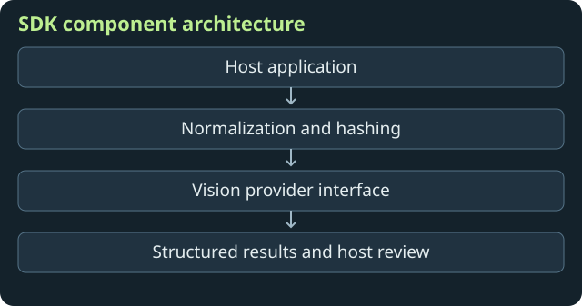
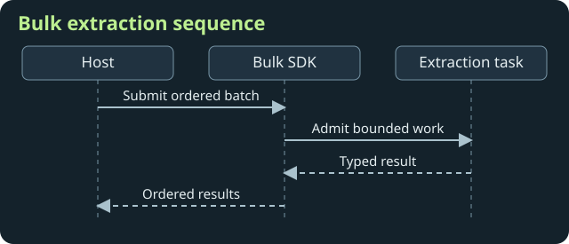
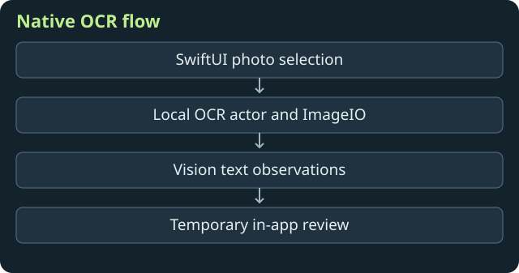
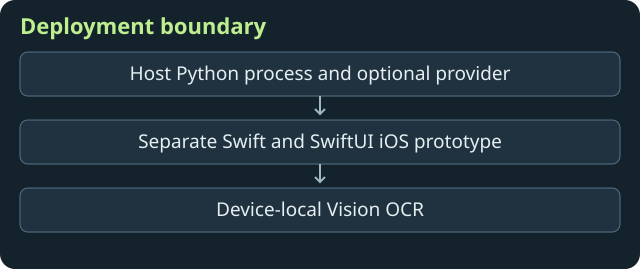

# Picker | Engineering case study

[Portfolio index](../../README.md) · [Website case study](../../picker.html)

## Application overview

The Python SDK normalizes images, computes exact and perceptual hashes, and maps configured vision-provider responses into versioned structured results. The host owns persistence and review. The SwiftUI prototype selects photos and runs local Vision OCR separately. Build, signing, simulator and iPhone behavior remain unverified.

## Technology stack

Python, Pydantic, Pillow, HTTPX, FFmpeg, OpenAI vision, Swift, SwiftUI, Apple Vision

## System architecture

## Flowcharts and component interactions

### Bulk extraction sequence

### Native OCR flow

### Deployment boundary

## Source code examples

These are exact, illustrative excerpts from the private source commits identified below. Each depends on surrounding application code, framework context, or schema and is not an independently runnable example. File extensions are retained for GitHub syntax highlighting.

### Normalize a screenshot

[Browse normalize-screenshot.py](examples/normalize-screenshot.py)

Origin: picker/processors/image.py:49–65, normalize_screenshot, commit c2fa78a48d2fc867cff85dd02f7219d3dae760ad.

The SDK prepares a consistent image before asking the vision provider to read it.

**Inputs, outputs, and control flow.** Receives image bytes and optional PickerConfig. Pillow applies EXIF orientation, handles alpha, and converts to RGB. Trimming and encoding produce image bytes, dimensions and coordinate-remapping metadata.

**Design decisions and security.** The byte limit runs before decode. Unreadable inputs raise ValueError with the underlying exception chained. Decoded dimensions merit their own budget. Hashing and provider work are downstream.

**Test evidence.** tests/test_picker.py covers normalization and extraction behavior. The Python suite passed 33 tests with external sockets blocked.

### Bound concurrent extraction

[Browse extract-screenshots-bulk.py](examples/extract-screenshots-bulk.py)

Origin: picker/services/extraction.py:207–214, extract_screenshots_bulk, commit c2fa78a48d2fc867cff85dd02f7219d3dae760ad.

The SDK processes several screenshots together while limiting simultaneous extraction calls.

**Inputs, outputs, and control flow.** Receives a bulk request, configuration and injected dependencies. A semaphore guards each async extraction. asyncio.gather collects results in input order and propagates errors.

**Design decisions and security.** Injected provider dependencies let tests avoid live API calls. Bounding active work does not bound the number of scheduled tasks or guarantee provider quota compliance. The host must control inputs and cancellation.

**Test evidence.** tests/test_picker.py exercises bounded bulk concurrency with injected dependencies.

### Run OCR on the device

[Browse LocalOCRService.swift](examples/LocalOCRService.swift)

Origin: ios/Picker/Services/LocalOCRService.swift:10–41, LocalOCRService, commit c2fa78a48d2fc867cff85dd02f7219d3dae760ad.

The Swift prototype reads text from an image on the device and returns its location in the image.

**Inputs, outputs, and control flow.** The actor accepts Data, uses ImageIO and Vision, and returns recognized text, confidence and normalized bounding boxes. Invalid images throw unsupportedImage. Task cancellation attempts to cancel the Vision request.

**Design decisions and security.** Actor isolation keeps work off the main actor. Orientation is read from the image metadata. The excerpt performs no network request. Cancellation checks surround synchronous Vision processing.

**Test evidence.** The iOS structural checker passed. Swift compilation, XCTest execution and device behavior were not verified.

## Testing and validation

33 Python tests passed with external socket connections blocked. The iOS structural checker passed. Swift compilation, signing, XCTest, simulator, and device behavior remain unverified.

## Security considerations and known limitations

Provider extraction sends normalized image content to the configured service. Heuristic detection can miss results. The iOS branch remains an unverified local OCR prototype.

## Future development roadmap

- Add an explicit decoded-pixel limit and test oversized compressed images.
- For large batches, consider a worker queue and explicit per-item outcomes.
- Move heavy image decoding behind a pixel budget and test rotated images and cancellation on a device.

## AI-assisted development

Designed and developed using AI-assisted software engineering tools, including ChatGPT and Codex.

## Expanded source review

[Full module collection](source/README.md) · [Pinned engineering metrics](../../METRICS.md)
