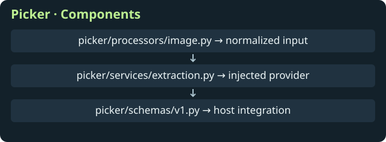
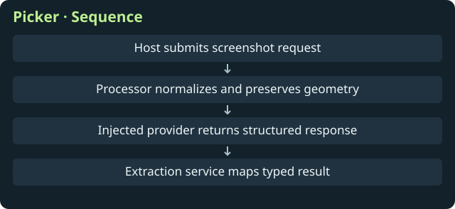

# Picker · Source collection

[Case study](../../../picker.html) · [Measurement method](../../../METRICS.md)

## Source status

An injected provider receives normalized image data. The extraction service maps responses into versioned schemas and supports bounded concurrency. The SwiftUI and native Vision path is independent.

This selection covers the screenshot SDK and native OCR. Restaurant-specific extraction and recording implementations remain private. Some package exports and tests may refer to omitted modules, so this is a source collection, not a runnable distribution.

These full files are transcribed from the pinned commit. Many depend on omitted application components. They are review material and are not offered as a runnable package.

## Implementation diagrams

## Module walkthroughs

### picker/__init__.py

[Browse the exact module](picker/__init__.py) · 16 nonblank lines · Services and modules

Expose selected SDK contracts at package import boundaries.

**Declarations and dependencies.** Static declarations or re-exports. Imports: from picker.capabilities import PickerCapabilitiesV1, get_capabilities, from picker.config import PickerConfig, from picker.hashing import calculate_hashes, compare_exact_hashes, compare_perceptual_hashes, from picker.processors import crop_content_region, normalize_screenshot, validate_crop, from picker.schemas import *, from picker.services import PickerDependencies, extract_screenshot, extract_screenshots_bulk, from picker.restaurant import aggregate_restaurant_evidence, classify_restaurant_source, extract_restaurant_screenshot, extract_restaurant_screenshots, normalize_phone, from picker.version import __version__, get_package_version, from picker.video import PickerVideoError, analyze_video, probe_video, reconstruct_caption

**Design and control flow.** Modular application boundary. An injected provider receives normalized image data. The extraction service maps responses into versioned schemas and supports bounded concurrency. The SwiftUI and native Vision path is independent.

**Error and security boundary.** No explicit raise found in the declaration scan. Errors may propagate from dependencies. Check input boundaries and scope where this module meets its callers. Runtime data and secrets belong outside the repository.

**Testing and trade-off.** Application test evidence is documented on the case study. The module retains the original interfaces and imports, which preserve design context and limit standalone execution.

### picker/api/__init__.py

[Browse the exact module](picker/api/__init__.py) · 1 nonblank lines · Services and modules

Expose selected SDK contracts at package import boundaries.

**Declarations and dependencies.** Static declarations or re-exports. Imports: No package-level imports detected.

**Design and control flow.** Modular application boundary. An injected provider receives normalized image data. The extraction service maps responses into versioned schemas and supports bounded concurrency. The SwiftUI and native Vision path is independent.

**Error and security boundary.** No explicit raise found in the declaration scan. Errors may propagate from dependencies. Check input boundaries and scope where this module meets its callers. Runtime data and secrets belong outside the repository.

**Testing and trade-off.** Application test evidence is documented on the case study. The module retains the original interfaces and imports, which preserve design context and limit standalone execution.

### picker/config.py

[Browse the exact module](picker/config.py) · 37 nonblank lines · Services and modules

Collect injectable limits and provider options for SDK calls.

**Declarations and dependencies.** PickerConfig Imports: from dataclasses import dataclass

**Design and control flow.** Typed or encapsulated state. An injected provider receives normalized image data. The extraction service maps responses into versioned schemas and supports bounded concurrency. The SwiftUI and native Vision path is independent.

**Error and security boundary.** No explicit raise found in the declaration scan. Errors may propagate from dependencies. Check input boundaries and scope where this module meets its callers. Runtime data and secrets belong outside the repository.

**Testing and trade-off.** Application test evidence is documented on the case study. The module retains the original interfaces and imports, which preserve design context and limit standalone execution.

### picker/exceptions.py

[Browse the exact module](picker/exceptions.py) · 10 nonblank lines · Services and modules

Describe typed failure categories consumed by callers.

**Declarations and dependencies.** PickerError, PickerConfigurationError, PickerTimeoutError, PickerProviderError, PickerStructuredOutputError Imports: No package-level imports detected.

**Design and control flow.** Typed or encapsulated state. An injected provider receives normalized image data. The extraction service maps responses into versioned schemas and supports bounded concurrency. The SwiftUI and native Vision path is independent.

**Error and security boundary.** No explicit raise found in the declaration scan. Errors may propagate from dependencies. Check input boundaries and scope where this module meets its callers. Runtime data and secrets belong outside the repository.

**Testing and trade-off.** Application test evidence is documented on the case study. The module retains the original interfaces and imports, which preserve design context and limit standalone execution.

### picker/hashing/__init__.py

[Browse the exact module](picker/hashing/__init__.py) · 20 nonblank lines · Services and modules

Produce exact byte hashes and a perceptual image hash.

**Declarations and dependencies.** perceptual_hash, calculate_hashes, compare_exact_hashes, compare_perceptual_hashes Imports: import hashlib, from PIL import Image

**Design and control flow.** Explicit resource or error handling. An injected provider receives normalized image data. The extraction service maps responses into versioned schemas and supports bounded concurrency. The SwiftUI and native Vision path is independent.

**Error and security boundary.** No explicit raise found in the declaration scan. Errors may propagate from dependencies. Check input boundaries and scope where this module meets its callers. Runtime data and secrets belong outside the repository.

**Testing and trade-off.** Application test evidence is documented on the case study. The module retains the original interfaces and imports, which preserve design context and limit standalone execution.

### picker/processors/image.py

[Browse the exact module](picker/processors/image.py) · 102 nonblank lines · Services and modules

Decode and normalize screenshots while retaining crop coordinates.

**Declarations and dependencies.** PreparedScreenshot, _safe_trim, _encode, normalize_screenshot, encode_for_edge, validate_crop, refine_crop_to_visible_edges, remap_box, crop_content_region Imports: import time, from dataclasses import dataclass, from io import BytesIO, from PIL import Image, ImageChops, ImageFilter, ImageOps, ImageStat, UnidentifiedImageError, from picker.config import PickerConfig, from picker.schemas import PickerBoundingBoxV1

**Design and control flow.** Typed or encapsulated state, Explicit resource or error handling. An injected provider receives normalized image data. The extraction service maps responses into versioned schemas and supports bounded concurrency. The SwiftUI and native Vision path is independent.

**Error and security boundary.** ValueError Check input boundaries and scope where this module meets its callers. Runtime data and secrets belong outside the repository.

**Testing and trade-off.** Application test evidence is documented on the case study. The module retains the original interfaces and imports, which preserve design context and limit standalone execution.

### picker/providers/base.py

[Browse the exact module](picker/providers/base.py) · 15 nonblank lines · Interfaces

Define a typed interface used across independently implemented adapters.

**Declarations and dependencies.** ProviderResponse, PickerVisionProvider Imports: from dataclasses import dataclass, from typing import Any, Protocol

**Design and control flow.** Asynchronous boundary, Typed or encapsulated state. An injected provider receives normalized image data. The extraction service maps responses into versioned schemas and supports bounded concurrency. The SwiftUI and native Vision path is independent.

**Error and security boundary.** No explicit raise found in the declaration scan. Errors may propagate from dependencies. Check input boundaries and scope where this module meets its callers. Runtime data and secrets belong outside the repository.

**Testing and trade-off.** Application test evidence is documented on the case study. The module retains the original interfaces and imports, which preserve design context and limit standalone execution.

### picker/schemas/v1.py

[Browse the exact module](picker/schemas/v1.py) · 281 nonblank lines · Models and contracts

Define versioned contracts for structured extraction and host integrations.

**Declarations and dependencies.** PickerDimensionsV1, PickerBoundingBoxV1, PickerConfidenceV1, PickerTextRegionV1, PickerListRegionV1, PickerContentRegionV1, PickerClassifiedTextV1, PickerCropV1, PickerAccountMetadataV1, PickerLocationMetadataV1, PickerEngagementMetadataV1, PickerProvenanceV1, PickerProcessingMetricsV1, PickerExtractionContextV1 Imports: from datetime import datetime, timezone, from typing import Any, Literal, from pydantic import BaseModel, Field

**Design and control flow.** Typed or encapsulated state. An injected provider receives normalized image data. The extraction service maps responses into versioned schemas and supports bounded concurrency. The SwiftUI and native Vision path is independent.

**Error and security boundary.** No explicit raise found in the declaration scan. Errors may propagate from dependencies. Check input boundaries and scope where this module meets its callers. Runtime data and secrets belong outside the repository.

**Testing and trade-off.** Application test evidence is documented on the case study. The module retains the original interfaces and imports, which preserve design context and limit standalone execution.

### picker/services/extraction.py

[Browse the exact module](picker/services/extraction.py) · 187 nonblank lines · Services and modules

Orchestrate normalized images, injected vision providers, typed results and bounded batches.

**Declarations and dependencies.** MetricsRecorder, PickerDependencies, _box, _confidence, _text, _listed, _fallback_reasons, _reconcile_classification, _remap_result_boxes, _to_result, extract_screenshot, extract_screenshots_bulk Imports: import asyncio, import re, import time, from dataclasses import dataclass, from datetime import datetime, timezone, from typing import Callable, Protocol, from uuid import uuid4, from picker.config import PickerConfig, from picker.exceptions import PickerStructuredOutputError, from picker.hashing import calculate_hashes, from picker.processors.image import PreparedScreenshot, encode_for_edge, normalize_screenshot, refine_crop_to_visible_edges, remap_box, validate_crop, from picker.providers import OpenAIVisionProvider, PickerVisionProvider, ProviderResponse

**Design and control flow.** Asynchronous boundary, Typed or encapsulated state, Explicit resource or error handling. An injected provider receives normalized image data. The extraction service maps responses into versioned schemas and supports bounded concurrency. The SwiftUI and native Vision path is independent.

**Error and security boundary.** PickerStructuredOutputError Check input boundaries and scope where this module meets its callers. Runtime data and secrets belong outside the repository.

**Testing and trade-off.** Application test evidence is documented on the case study. The module retains the original interfaces and imports, which preserve design context and limit standalone execution.

### picker/storage/__init__.py

[Browse the exact module](picker/storage/__init__.py) · 4 nonblank lines · Services and modules

Define optional storage interfaces for host-supplied persistence.

**Declarations and dependencies.** PickerStorageAdapter Imports: from typing import Protocol

**Design and control flow.** Typed or encapsulated state. An injected provider receives normalized image data. The extraction service maps responses into versioned schemas and supports bounded concurrency. The SwiftUI and native Vision path is independent.

**Error and security boundary.** No explicit raise found in the declaration scan. Errors may propagate from dependencies. Check input boundaries and scope where this module meets its callers. Runtime data and secrets belong outside the repository.

**Testing and trade-off.** Application test evidence is documented on the case study. The module retains the original interfaces and imports, which preserve design context and limit standalone execution.

### picker/capabilities.py

[Browse the exact module](picker/capabilities.py) · 8 nonblank lines · Services and modules

Describe SDK capability flags used by consuming applications.

**Declarations and dependencies.** PickerCapabilitiesV1, get_capabilities Imports: from pydantic import BaseModel

**Design and control flow.** Typed or encapsulated state. An injected provider receives normalized image data. The extraction service maps responses into versioned schemas and supports bounded concurrency. The SwiftUI and native Vision path is independent.

**Error and security boundary.** No explicit raise found in the declaration scan. Errors may propagate from dependencies. Check input boundaries and scope where this module meets its callers. Runtime data and secrets belong outside the repository.

**Testing and trade-off.** Application test evidence is documented on the case study. The module retains the original interfaces and imports, which preserve design context and limit standalone execution.

### ios/Picker/App/PickerApp.swift

[Browse the exact module](ios/Picker/App/PickerApp.swift) · 7 nonblank lines · Frontend and native components

Define the entry point for the SwiftUI prototype.

**Declarations and dependencies.** PickerApp Imports: import SwiftUI

**Design and control flow.** Typed or encapsulated state. An injected provider receives normalized image data. The extraction service maps responses into versioned schemas and supports bounded concurrency. The SwiftUI and native Vision path is independent.

**Error and security boundary.** No explicit raise found in the declaration scan. Errors may propagate from dependencies. Keep photo and OCR data device-local in this path. Test cancellation and temporary-file behavior on hardware before claiming release readiness.

**Testing and trade-off.** Application test evidence is documented on the case study. The module retains the original interfaces and imports, which preserve design context and limit standalone execution.

### ios/Picker/Services/LocalOCRService.swift

[Browse the exact module](ios/Picker/Services/LocalOCRService.swift) · 39 nonblank lines · Frontend and native components

Decode input image bytes and perform device-local Vision OCR.

**Declarations and dependencies.** LocalOCRService, recognize Imports: import Foundation, import ImageIO, import Vision

**Design and control flow.** Asynchronous boundary, Typed or encapsulated state, Explicit resource or error handling. An injected provider receives normalized image data. The extraction service maps responses into versioned schemas and supports bounded concurrency. The SwiftUI and native Vision path is independent.

**Error and security boundary.** throws or catches an error Keep photo and OCR data device-local in this path. Test cancellation and temporary-file behavior on hardware before claiming release readiness.

**Testing and trade-off.** Application test evidence is documented on the case study. The module retains the original interfaces and imports, which preserve design context and limit standalone execution.

### ios/Picker/Views/PickerHomeView.swift

[Browse the exact module](ios/Picker/Views/PickerHomeView.swift) · 118 nonblank lines · Frontend and native components

Coordinate photo selection, extraction and review in SwiftUI.

**Declarations and dependencies.** PickerHomeView, importImage, endSession Imports: import PhotosUI, import SwiftUI,             importImage(item),         importing = true,                 importing = false,                 importing = false,         importing = false

**Design and control flow.** Typed or encapsulated state, Explicit resource or error handling. An injected provider receives normalized image data. The extraction service maps responses into versioned schemas and supports bounded concurrency. The SwiftUI and native Vision path is independent.

**Error and security boundary.** throws or catches an error Keep photo and OCR data device-local in this path. Test cancellation and temporary-file behavior on hardware before claiming release readiness.

**Testing and trade-off.** Application test evidence is documented on the case study. The module retains the original interfaces and imports, which preserve design context and limit standalone execution.

### ios/Shared/Models/PickerSession.swift

[Browse the exact module](ios/Shared/Models/PickerSession.swift) · 64 nonblank lines · Frontend and native components

Hold state across the native Picker review session.

**Declarations and dependencies.** PickerSession, begin, selectSource, startProcessing, review, complete, cancel, purge Imports: import Combine, import Foundation

**Design and control flow.** Typed or encapsulated state, Explicit resource or error handling. An injected provider receives normalized image data. The extraction service maps responses into versioned schemas and supports bounded concurrency. The SwiftUI and native Vision path is independent.

**Error and security boundary.** throws or catches an error Keep photo and OCR data device-local in this path. Test cancellation and temporary-file behavior on hardware before claiming release readiness.

**Testing and trade-off.** Application test evidence is documented on the case study. The module retains the original interfaces and imports, which preserve design context and limit standalone execution.

### ios/Shared/Models/RecognizedTextItem.swift

[Browse the exact module](ios/Shared/Models/RecognizedTextItem.swift) · 21 nonblank lines · Frontend and native components

Represent OCR results with text, confidence and bounds.

**Declarations and dependencies.** TextBoundingBox, RecognizedTextItem Imports: import Foundation

**Design and control flow.** Typed or encapsulated state, Explicit resource or error handling. An injected provider receives normalized image data. The extraction service maps responses into versioned schemas and supports bounded concurrency. The SwiftUI and native Vision path is independent.

**Error and security boundary.** No explicit raise found in the declaration scan. Errors may propagate from dependencies. Keep photo and OCR data device-local in this path. Test cancellation and temporary-file behavior on hardware before claiming release readiness.

**Testing and trade-off.** Application test evidence is documented on the case study. The module retains the original interfaces and imports, which preserve design context and limit standalone execution.

### ios/Shared/Services/SessionTemporaryFiles.swift

[Browse the exact module](ios/Shared/Services/SessionTemporaryFiles.swift) · 14 nonblank lines · Frontend and native components

Manage temporary review files over a session lifetime.

**Declarations and dependencies.** SessionTemporaryFiles, removeAbandonedFiles Imports: import Foundation

**Design and control flow.** Typed or encapsulated state, Explicit resource or error handling. An injected provider receives normalized image data. The extraction service maps responses into versioned schemas and supports bounded concurrency. The SwiftUI and native Vision path is independent.

**Error and security boundary.** No explicit raise found in the declaration scan. Errors may propagate from dependencies. Keep photo and OCR data device-local in this path. Test cancellation and temporary-file behavior on hardware before claiming release readiness.

**Testing and trade-off.** Application test evidence is documented on the case study. The module retains the original interfaces and imports, which preserve design context and limit standalone execution.

### tests/test_picker.py

[Browse the exact module](tests/test_picker.py) · 138 nonblank lines · Tests

Exercise observable behavior with local test fixtures and assertions.

**Declarations and dependencies.** image_bytes, extraction, response, FakeProvider, request, test_version_and_capabilities, test_orientation_normalization, test_margin_trimming_and_resizing, test_hashing_and_duplicate_primitives, test_crop_validation_and_creation, test_single_extraction_contract_and_classification, test_low_confidence_triggers_fallback, test_invalid_crop_triggers_fallback, test_structured_failure_triggers_fallback Imports: import asyncio, from datetime import datetime, timezone, from io import BytesIO, import pytest, from PIL import Image, ImageDraw, from picker import PickerBulkExtractionRequestV1, PickerConfig, PickerDependencies, PickerExtractionContextV1, PickerExtractionRequestV1, calculate_hashes, compare_exact_hashes, compare_perceptual_hashes, crop_content_region, extract_screenshot, extract_screenshots_bulk, get_capabilities, get_package_version, normalize_screenshot, validate_crop, from picker.exceptions import PickerProviderError, PickerStructuredOutputError, from picker.providers import ProviderResponse, from picker.providers.openai import CompactExtraction, from picker.schemas import PickerBoundingBoxV1, from picker.video import ingest_video

**Design and control flow.** Asynchronous boundary, Typed or encapsulated state, Explicit resource or error handling, Fixture-based behavioral verification. An injected provider receives normalized image data. The extraction service maps responses into versioned schemas and supports bounded concurrency. The SwiftUI and native Vision path is independent.

**Error and security boundary.** value Fixtures exercise local behavior. Review fixture provenance and keep credentials and customer data out of public examples.

**Testing and trade-off.** Application test evidence is documented on the case study. The module retains the original interfaces and imports, which preserve design context and limit standalone execution.

### examples/authenticityai_adapter.py

[Browse the exact module](examples/authenticityai_adapter.py) · 14 nonblank lines · Services and modules

Demonstrate how a host might map Picker outputs to a separate evidence pipeline.

**Declarations and dependencies.** to_authenticity_inputs Imports: from picker import PickerExtractionResultV1

**Design and control flow.** Modular application boundary. An injected provider receives normalized image data. The extraction service maps responses into versioned schemas and supports bounded concurrency. The SwiftUI and native Vision path is independent.

**Error and security boundary.** No explicit raise found in the declaration scan. Errors may propagate from dependencies. Check input boundaries and scope where this module meets its callers. Runtime data and secrets belong outside the repository.

**Testing and trade-off.** Application test evidence is documented on the case study. The module retains the original interfaces and imports, which preserve design context and limit standalone execution.

## AI-assisted development

Designed and developed using AI-assisted software engineering tools, including ChatGPT and Codex.
