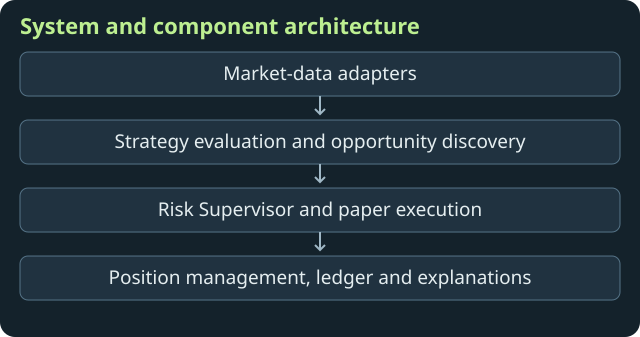
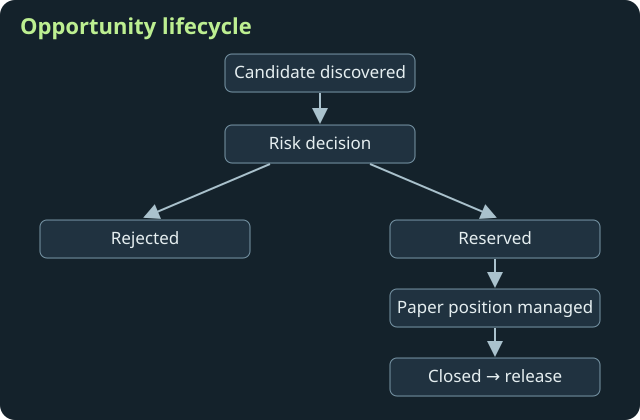
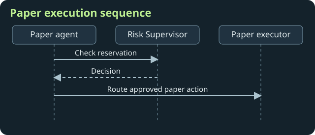
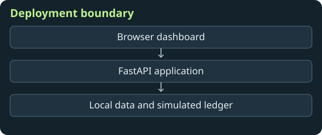

# SLEEP | Engineering case study

[Portfolio index](../../README.md) · [Website case study](../../sleep.html)

## Application overview

Paper agents consume market data, evaluate strategy candidates and discover opportunities. Application policy controls reservation and simulated execution. Position handling feeds portfolio accounting and explanation views. Strategy logic, ranking, limits, and production configuration are outside these excerpts.

## Technology stack

Python, FastAPI, SQLite, browser JavaScript, market-data APIs, optional OpenAI

## System architecture

## Flowcharts and component interactions

### Opportunity lifecycle

### Paper execution sequence

### Deployment boundary

## Source code examples

These are exact, illustrative excerpts from the private source commits identified below. Each depends on surrounding application code, framework context, or schema and is not an independently runnable example. File extensions are retained for GitHub syntax highlighting.

### Reserve a risk budget

[Browse reserve-risk-budget.py](examples/reserve-risk-budget.py)

Origin: app/risk_supervisor.py:99–103, SharedRiskSupervisor.reserve, commit f48707ab18e914a100f9748605997cbfd745271e.

The method asks the shared supervisor for permission before it records an opportunity.

**Inputs, outputs, and control flow.** A RiskReservation and portfolio equity go to evaluate. A denial raises ValueError with the reason. Success writes one entry keyed by opportunity ID and returns None.

**Design decisions and security.** The supervisor owns reservation state. The paper execution path can act only after allocation succeeds. The excerpt omits the strategy, ranking policy, and numerical limits. Evaluate can update observed equity even when no reservation is written.

**Test evidence.** tests/test_decision_flow_accounting.py checks repeated reservations replace the same opportunity.

## Testing and validation

The pinned source includes Python and browser regression tests and Linux release validation. The application suite was not rerun during the portfolio review.

## Security considerations and known limitations

Execution is paper-only. This walkthrough omits trading strategy, scoring rules, numeric risk settings, and production configuration. Deployment health and investment outcomes are outside the portfolio claims.

## Future development roadmap

- If callers can reserve concurrently, make evaluation and mutation atomic and verify that the simulation and ledger agree.

## AI-assisted development

Development and preparation of this portfolio included AI assistance. The code is transcribed from verified commits. Individual implementation authorship is not asserted.

## Expanded source review

[Full module collection](source/README.md) · [Pinned engineering metrics](../../METRICS.md)
