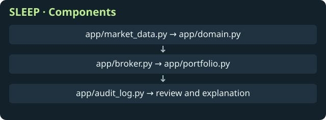
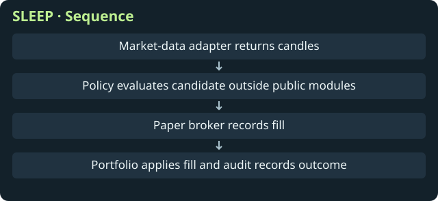

# SLEEP · Source collection

[Case study](../../../sleep.html) · [Measurement method](../../../METRICS.md)

## Source status

Public market data flows through adapters to simulated execution and portfolio state. Agent telemetry, audit records and explanations expose outcomes without the strategy ranking and risk thresholds.

Agent orchestration, opportunity ranking, risk policy and strategy implementations require excerpt-specific IP review. The full risk supervisor and strategy files are withheld.

These full files are transcribed from the pinned commit. Many depend on omitted application components. They are review material and are not offered as a runnable package.

## Implementation diagrams

## Module walkthroughs

### app/market_data.py

[Browse the exact module](app/market_data.py) · 184 nonblank lines · Services and modules

Load and normalize market candles before strategies or simulations consume them.

**Declarations and dependencies.** MarketDataError, KrakenMarketData, CsvMarketData, DemoMarketData, YahooMarketData, _aggregate, ResilientMarketData Imports: from __future__ import annotations, import csv, import json, import math, import random, from datetime import datetime, timedelta, timezone, from pathlib import Path, from urllib.parse import urlencode, from urllib.request import Request, urlopen, from .assets import PLATFORM_SYMBOLS, from .domain import Candle, SUPPORTED_SYMBOLS

**Design and control flow.** Typed or encapsulated state, Explicit resource or error handling. Public market data flows through adapters to simulated execution and portfolio state. Agent telemetry, audit records and explanations expose outcomes without the strategy ranking and risk thresholds.

**Error and security boundary.** MarketDataError Treat remote responses as untrusted. Review timeouts, bounds and retry behavior before deploying.

**Testing and trade-off.** Application test evidence is documented on the case study. The module retains the original interfaces and imports, which preserve design context and limit standalone execution.

### app/broker.py

[Browse the exact module](app/broker.py) · 28 nonblank lines · Services and modules

Represent a paper broker boundary and simulated fill handling.

**Declarations and dependencies.** PaperBroker, LiveBrokerDisabled Imports: from __future__ import annotations, from .domain import Order, Side, Trade, from .portfolio import Portfolio

**Design and control flow.** Typed or encapsulated state. Public market data flows through adapters to simulated execution and portfolio state. Agent telemetry, audit records and explanations expose outcomes without the strategy ranking and risk thresholds.

**Error and security boundary.** RuntimeError, ValueError Preserve the paper-only execution boundary and reconcile state with simulated fills. Live deployment is outside this selection.

**Testing and trade-off.** Application test evidence is documented on the case study. The module retains the original interfaces and imports, which preserve design context and limit standalone execution.

### app/portfolio.py

[Browse the exact module](app/portfolio.py) · 75 nonblank lines · Services and modules

Track cash, holdings, cost basis and equity through paper fills.

**Declarations and dependencies.** PortfolioError, Portfolio Imports: from __future__ import annotations, from datetime import date, datetime, from .domain import EquityPoint, Position, Side, Trade, SUPPORTED_SYMBOLS

**Design and control flow.** Typed or encapsulated state. Public market data flows through adapters to simulated execution and portfolio state. Agent telemetry, audit records and explanations expose outcomes without the strategy ranking and risk thresholds.

**Error and security boundary.** PortfolioError Preserve the paper-only execution boundary and reconcile state with simulated fills. Live deployment is outside this selection.

**Testing and trade-off.** Application test evidence is documented on the case study. The module retains the original interfaces and imports, which preserve design context and limit standalone execution.

### app/domain.py

[Browse the exact module](app/domain.py) · 91 nonblank lines · Services and modules

Define shared records passed between market data, execution and accounting.

**Declarations and dependencies.** Side, Candle, FeatureVector, ModelSignal, Order, Trade, Position, EquityPoint Imports: from __future__ import annotations, from dataclasses import dataclass, field, from datetime import datetime, timezone, from enum import Enum

**Design and control flow.** Typed or encapsulated state. Public market data flows through adapters to simulated execution and portfolio state. Agent telemetry, audit records and explanations expose outcomes without the strategy ranking and risk thresholds.

**Error and security boundary.** ValueError Check input boundaries and scope where this module meets its callers. Runtime data and secrets belong outside the repository.

**Testing and trade-off.** Application test evidence is documented on the case study. The module retains the original interfaces and imports, which preserve design context and limit standalone execution.

### app/modes.py

[Browse the exact module](app/modes.py) · 48 nonblank lines · Services and modules

Represent operating modes and expose routing policy as application state.

**Declarations and dependencies.** OperatingMode, ModePolicy, policy_for, require_permission Imports: from __future__ import annotations, from dataclasses import asdict, dataclass, from enum import Enum

**Design and control flow.** Typed or encapsulated state, Explicit resource or error handling. Public market data flows through adapters to simulated execution and portfolio state. Agent telemetry, audit records and explanations expose outcomes without the strategy ranking and risk thresholds.

**Error and security boundary.** PermissionError, ValueError Check input boundaries and scope where this module meets its callers. Runtime data and secrets belong outside the repository.

**Testing and trade-off.** Application test evidence is documented on the case study. The module retains the original interfaces and imports, which preserve design context and limit standalone execution.

### app/audit_log.py

[Browse the exact module](app/audit_log.py) · 102 nonblank lines · Services and modules

Record and expose structured operation events for review.

**Declarations and dependencies.** AuditEvent, AuditLog Imports: from __future__ import annotations, import csv, import io, from dataclasses import dataclass, from datetime import datetime, timezone, from threading import Lock, from uuid import uuid4

**Design and control flow.** Typed or encapsulated state, Explicit resource or error handling. Public market data flows through adapters to simulated execution and portfolio state. Agent telemetry, audit records and explanations expose outcomes without the strategy ranking and risk thresholds.

**Error and security boundary.** ValueError Check input boundaries and scope where this module meets its callers. Runtime data and secrets belong outside the repository.

**Testing and trade-off.** Application test evidence is documented on the case study. The module retains the original interfaces and imports, which preserve design context and limit standalone execution.

### app/manual_explanation.py

[Browse the exact module](app/manual_explanation.py) · 19 nonblank lines · Services and modules

Translate execution and position context into explanation output.

**Declarations and dependencies.** explain_manual Imports: import re

**Design and control flow.** Modular application boundary. Public market data flows through adapters to simulated execution and portfolio state. Agent telemetry, audit records and explanations expose outcomes without the strategy ranking and risk thresholds.

**Error and security boundary.** No explicit raise found in the declaration scan. Errors may propagate from dependencies. Check input boundaries and scope where this module meets its callers. Runtime data and secrets belong outside the repository.

**Testing and trade-off.** Application test evidence is documented on the case study. The module retains the original interfaces and imports, which preserve design context and limit standalone execution.

### app/account_schemas.py

[Browse the exact module](app/account_schemas.py) · 29 nonblank lines · Services and modules

Define typed contracts for account-related inputs and outputs.

**Declarations and dependencies.** NotificationPreferences, TesterSettingsRequest Imports: from typing import Literal, from pydantic import BaseModel, ConfigDict, Field, StrictBool, field_validator

**Design and control flow.** Typed or encapsulated state. Public market data flows through adapters to simulated execution and portfolio state. Agent telemetry, audit records and explanations expose outcomes without the strategy ranking and risk thresholds.

**Error and security boundary.** ValueError Check input boundaries and scope where this module meets its callers. Runtime data and secrets belong outside the repository.

**Testing and trade-off.** Application test evidence is documented on the case study. The module retains the original interfaces and imports, which preserve design context and limit standalone execution.

### app/news_context.py

[Browse the exact module](app/news_context.py) · 37 nonblank lines · Services and modules

Provide market-news context for consumers without making trade decisions.

**Declarations and dependencies.** NewsCategory, ContextEvent, overlay_schema Imports: from __future__ import annotations, from dataclasses import asdict, dataclass, from datetime import datetime, from enum import Enum

**Design and control flow.** Typed or encapsulated state. Public market data flows through adapters to simulated execution and portfolio state. Agent telemetry, audit records and explanations expose outcomes without the strategy ranking and risk thresholds.

**Error and security boundary.** No explicit raise found in the declaration scan. Errors may propagate from dependencies. Treat remote responses as untrusted. Review timeouts, bounds and retry behavior before deploying.

**Testing and trade-off.** Application test evidence is documented on the case study. The module retains the original interfaces and imports, which preserve design context and limit standalone execution.

### tests/test_portfolio.py

[Browse the exact module](tests/test_portfolio.py) · 33 nonblank lines · Tests

Exercise observable behavior with local test fixtures and assertions.

**Declarations and dependencies.** trade, test_buy_updates_cash_quantity_and_fee_adjusted_cost_basis, test_partial_sell_realizes_net_profit_and_keeps_cost_basis, test_rejects_oversell_and_overspend, test_equity_and_drawdown_marking Imports: from datetime import datetime, timezone, import pytest, from app.domain import Side, Trade, from app.portfolio import Portfolio, PortfolioError

**Design and control flow.** Explicit resource or error handling, Fixture-based behavioral verification. Public market data flows through adapters to simulated execution and portfolio state. Agent telemetry, audit records and explanations expose outcomes without the strategy ranking and risk thresholds.

**Error and security boundary.** No explicit raise found in the declaration scan. Errors may propagate from dependencies. Fixtures exercise local behavior. Review fixture provenance and keep credentials and customer data out of public examples.

**Testing and trade-off.** Application test evidence is documented on the case study. The module retains the original interfaces and imports, which preserve design context and limit standalone execution.

### tests/test_decision_flow_accounting.py

[Browse the exact module](tests/test_decision_flow_accounting.py) · 66 nonblank lines · Tests

Exercise observable behavior with local test fixtures and assertions.

**Declarations and dependencies.** NoMarketService, test_restore_rebuilds_stale_reservations_from_actual_open_spot_holding, test_repeated_reserve_replaces_same_opportunity_instead_of_double_counting, test_setup_deduplication_records_suppression_and_allows_material_change, test_activity_ui_translates_states_and_preserves_expandable_audit_detail Imports: import json, from datetime import timedelta, from types import SimpleNamespace, import pytest, from app.opportunities import OpportunityState, from app.platform_service import PlatformService, from app.risk_supervisor import RiskReservation, SharedRiskSupervisor

**Design and control flow.** Typed or encapsulated state, Fixture-based behavioral verification. Public market data flows through adapters to simulated execution and portfolio state. Agent telemetry, audit records and explanations expose outcomes without the strategy ranking and risk thresholds.

**Error and security boundary.** No explicit raise found in the declaration scan. Errors may propagate from dependencies. Fixtures exercise local behavior. Review fixture provenance and keep credentials and customer data out of public examples.

**Testing and trade-off.** Application test evidence is documented on the case study. The module retains the original interfaces and imports, which preserve design context and limit standalone execution.

### tests/test_agent_telemetry.py

[Browse the exact module](tests/test_agent_telemetry.py) · 141 nonblank lines · Tests

Exercise observable behavior with local test fixtures and assertions.

**Declarations and dependencies.** dashboard, telemetry_service, add_pair, add_derivative, add_spot, test_telemetry_contract_for_every_family_combination, test_recovered_pair_schema_matches_live_created_schema, test_supervisor_totals_use_open_positions_not_larger_risk_reservations, test_snipe_windows_group_candidates_without_hiding_audit_detail, test_canonical_endpoint_and_frontend_collection_guards Imports: from datetime import datetime, timezone, from pathlib import Path, from types import SimpleNamespace, import pytest, from fastapi.testclient import TestClient, from app.derivatives import DerivativeSpec, DerivativesResearchAccount, from app.audit_log import AuditLog, from app.main import app, from app.pairs_research import SharedPairPaperAccount, from app.platform_service import PlatformService, from app.risk_supervisor import RiskReservation, SharedRiskSupervisor

**Design and control flow.** Fixture-based behavioral verification. Public market data flows through adapters to simulated execution and portfolio state. Agent telemetry, audit records and explanations expose outcomes without the strategy ranking and risk thresholds.

**Error and security boundary.** No explicit raise found in the declaration scan. Errors may propagate from dependencies. Fixtures exercise local behavior. Review fixture provenance and keep credentials and customer data out of public examples.

**Testing and trade-off.** Application test evidence is documented on the case study. The module retains the original interfaces and imports, which preserve design context and limit standalone execution.

## AI-assisted development

Designed and developed using AI-assisted software engineering tools, including ChatGPT and Codex.
